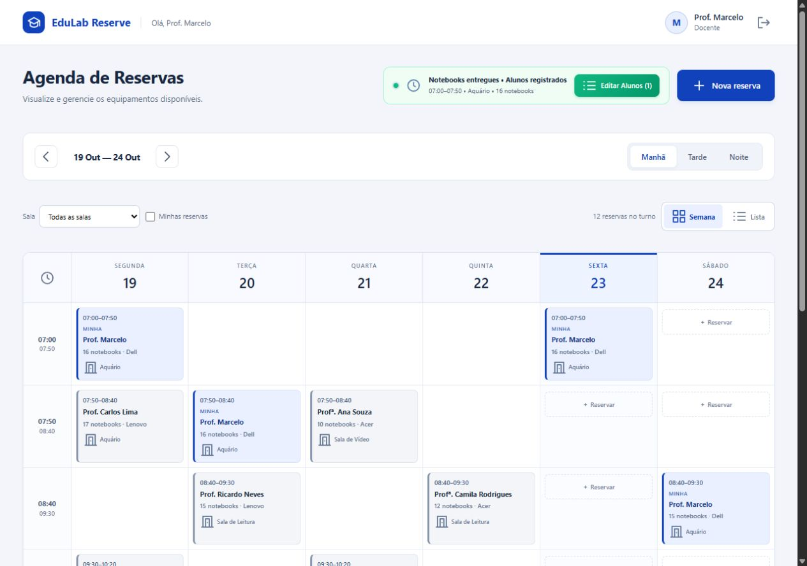

# Alceu Reservas

Sistema web para organizar reservas escolares de salas e notebooks. Professores consultam a agenda e planejam aulas; a Coordenação acompanha reservas, administra recursos e bloqueios e confirma a retirada dos equipamentos.

**[Acessar o sistema](https://app.reservas-alceu.workers.dev)** · Para conhecer sem uma conta, use **Professor demo** ou **Coordenação demo** na tela inicial. Os dados de demonstração são fictícios e ficam isolados da API e do banco de produção.



*Captura real de uma versão anterior da agenda do professor, mantida entre os arquivos do projeto. A interface publicada evoluiu desde essa captura; consulte a demonstração para ver as telas atuais.*

## O que dá para fazer

- **Planejar aulas:** consultar a agenda semanal, escolher data e horário e reservar uma sala, notebooks ou ambos.
- **Acompanhar reservas:** ver as próximas aulas e cancelar uma reserva própria quando permitido.
- **Gerir os recursos:** a Coordenação cadastra salas e equipamentos, acompanha a agenda e cria ou remove bloqueios.
- **Organizar a retirada:** a Coordenação confirma a retirada de notebooks no horário reservado; depois, o professor pode registrar os alunos que utilizarão os equipamentos.
- **Comunicar problemas:** durante uma aula com notebooks, o professor pode relatar um defeito pela etiqueta do equipamento. A Coordenação consulta e acompanha os relatos.
- **Acessar com segurança:** entrar com Google ou e-mail e senha confirmados; a API verifica as permissões de cada perfil.

## Perfis do sistema

| Professor | Coordenação |
| --- | --- |
| Consulta a agenda e cria reservas para si. | Consulta e administra reservas e recursos. |
| Acompanha e cancela suas próprias reservas. | Gerencia salas, equipamentos e bloqueios. |
| Registra alunos após a confirmação de retirada. | Confirma retiradas durante o horário da reserva. |
| Reporta defeitos de notebooks durante a aula. | Consulta relatos de defeitos e marca a leitura. |

## Tecnologias e arquitetura

- **Interface:** HTML, CSS e JavaScript.
- **Servidor:** Cloudflare Workers, com API de sessão e operações do sistema.
- **Dados:** Cloudflare D1 (SQL); as migrações ficam em `migrations/`.
- **Autenticação:** Firebase Authentication para login Google, e-mail e senha e verificação de e-mail.
- **Testes automatizados:** Node.js, SQLite em memória e Playwright para cobertura de regras, API e interface.

O Worker serve os arquivos estáticos e a API. As permissões são verificadas no servidor. O navegador mantém um cache temporário em memória e consulta atualizações periodicamente; dados de contas, reservas, equipamentos, salas, bloqueios e relatos são armazenados no banco.

## Executar localmente

**Pré-requisitos:** Node.js 24 e npm.

```powershell
npm install
npm run db:migrate:local
npm run dev
```

Abra <http://127.0.0.1:8787>. O banco local é separado do ambiente publicado. Para autenticar no endereço local, crie `.dev.vars` com `FIREBASE_PROJECT_ID` e `FIREBASE_WEB_API_KEY` e autorize o host local no Firebase Authentication. Não versione `.dev.vars`.

A Coordenação precisa ser promovida explicitamente por um administrador no D1, usando o UID Firebase verificado da conta:

```sql
UPDATE contas SET papel = 'coordenacao'
WHERE identidade_externa = 'firebase:projetotcc-3ds:UID_DA_PESSOA';
```

Opcionalmente, carregue salas fictícias apenas no banco local:

```powershell
npm run db:seed:local
```

## Comandos úteis

| Comando | Finalidade |
| --- | --- |
| `npm run dev` | Inicia o Worker local na porta 8787. |
| `npm run build` | Gera os arquivos estáticos e o pacote Firebase em `public/`. |
| `npm run db:migrate:local` | Aplica migrações ao banco local. |
| `npm run test` | Executa testes de regras, autenticação, API e esquema. |
| `npm run test:ui` | Executa os testes automatizados da interface. |
| `npm run check:worker` | Prepara o Worker e verifica o pacote com `wrangler deploy --dry-run`. |
| `npm run test:http` | Verifica o servidor local com `npm run dev` em execução. |

## Estrutura do projeto

```text
index.html, pages/       telas de acesso, professor e coordenação
css/                     estilos e responsividade
js/                      agenda, reservas, recursos e integração da interface
firebase/client.mjs      autenticação Firebase
src/                     Worker, API, sessões e regras do sistema
migrations/              migrações do banco D1
seeds/                   dados de exemplo para desenvolvimento local
tests/                   testes automatizados
scripts/build.mjs        geração dos arquivos em public/
```

## Regras importantes

- Novas contas recebem o perfil Professor. A confirmação do e-mail é obrigatória para entrar com e-mail e senha.
- Conflitos de sala, estoque e bloqueios são validados pelo servidor no momento da gravação, inclusive em operações concorrentes.
- O horário e as validações usam o fuso `America/Sao_Paulo`.
- A Coordenação confirma retiradas durante o horário reservado. O registro de alunos depende dessa confirmação e fica visível ao professor responsável e à Coordenação.
- Reservas afetadas por bloqueios permanecem no histórico e são identificadas como bloqueadas.
- Relatos de defeito não alteram estoque automaticamente e não atribuem responsabilidade ao aluno.
- A demonstração usa dados fictícios isolados. Ela não autentica nem concede acesso às APIs de produção.

## Publicação

O build gera os arquivos em `public/`. A publicação existente usa Cloudflare Workers e D1. Antes de publicar, revise as migrações e confira as configurações do ambiente. As migrações não são executadas automaticamente pelo build. Nenhum deploy é iniciado pelos comandos de desenvolvimento acima.

## Licença

Consulte [LICENSE](LICENSE).
